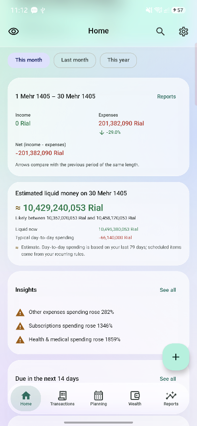
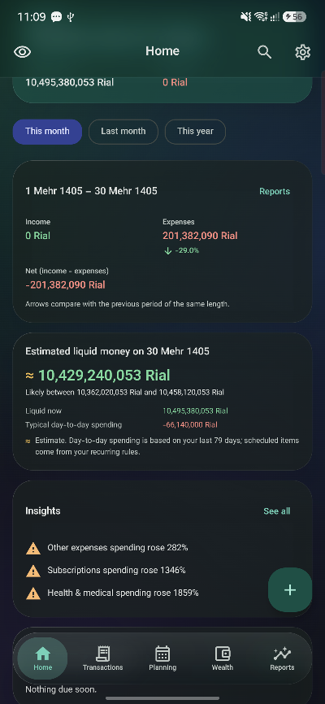
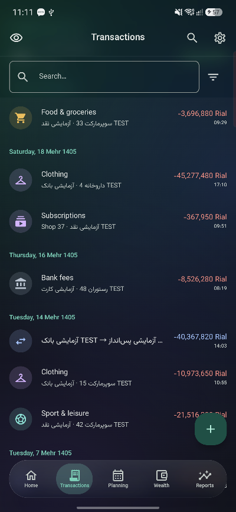
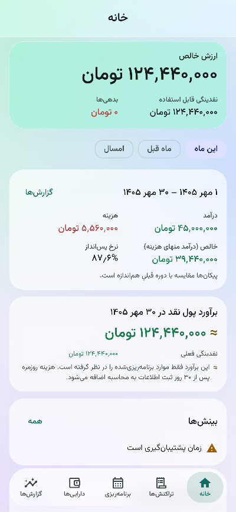
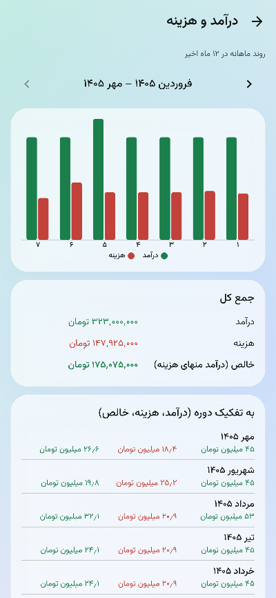
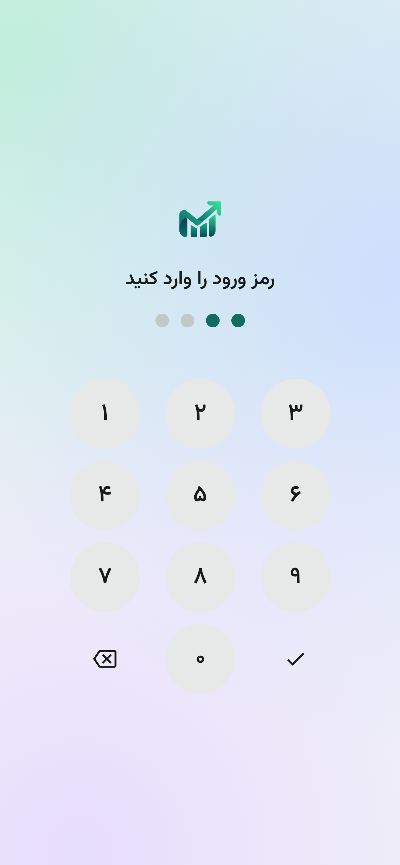

# MyMoney — private personal finance for Android

**[فارسی](README.fa.md)** · English

An offline, encrypted, bilingual (Persian RTL / English LTR) money manager: accounts, transactions, budgets,
bills and subscriptions, debts and receivables, assets, savings goals, reports and insights, with the Persian
(Jalali) calendar and exact rial/toman handling.

<p>
  
  
  
  
</p>
<p>
  
  
</p>

## Download
Get the APK from the [Releases](../../releases) page, open it on your phone and tap **Install**
(Android 8.0 or newer; allow "Install unknown apps" for your browser or file manager when asked).

> The release APK is signed with the author's development key, which is fine for installing and sharing.
> Updates must come from the same source; see [BUILD.md](BUILD.md#امضا) to sign builds with your own key.

## Highlights
- **Your data stays on your phone.** No internet permission at all; nothing is sent anywhere. Data leaves the
  device only when you export or back up. The database (SQLCipher) and receipts are encrypted with a key held in
  the Android Keystore.
- **Correct money.** Integer minor units, no floating point; IRR stored in rial with toman as an exact ×10
  display unit; multi-currency with manual and implied exchange rates; transfers never counted as income or
  spending; reports always add up to the dashboard.
- **Jalali and Gregorian calendars**, Persian or Latin digits, full RTL layout, Vazirmatn font.
- **Planning:** budgets with rollover and alerts, recurring bills and subscriptions with a payment calendar,
  loans with principal/interest split, assets with average-cost gains, savings goals with projections.
- **13 reports + insights:** trends, cash flow, net worth with exchange-rate effect, fixed vs variable, budget
  vs actual and more; locally computed insights that always show the numbers behind them.
- **Security:** PIN with growing delays (never stored, PBKDF2 + Keystore), fingerprint, auto-lock, screenshot
  blocking, encrypted receipts, "delete all data".
- **Data exchange:** encrypted `.mmbak` backup and verified restore, CSV import with column mapping and
  duplicate detection (undoable), CSV / JSON / PDF export, 30-day trash.
- **Liquid-glass design:** soft ambient colours, frosted cards and real blur behind the floating bars
  (Android 12+), themed icon on Android 13+; can be switched off.

## Build
Requirements: JDK 21, Android SDK (platform 37, build-tools 36). Then:
```bash
./gradlew assembleDebug          # debug APK
./gradlew :core:domain:test testDebugUnitTest lintDebug
./gradlew dist                   # release APK + AAB in dist/
```
Details (signing, on-device tests, benchmark): [BUILD.md](BUILD.md).

## Architecture
Kotlin · Jetpack Compose · Material 3 · Clean Architecture + MVVM · Room + SQLCipher · Hilt · DataStore ·
WorkManager · Google Tink.

| Module | Role |
|---|---|
| `core:domain` | Pure Kotlin: money, calendars, financial rules, calculators, use cases (no Android) |
| `core:data` | Room database, repositories, encryption, backup, import/export |
| `core:designsystem` | Theme, glass effects, components, charts |
| `app` | Screens, navigation, background worker, lock |

Design documents (Persian): [docs/](docs/): scope, architecture, data model, the
[financial business rules](docs/04-financial-business-rules.md), screens, design system, test plan,
[security](docs/SECURITY.md), [backup & restore](docs/BACKUP_RESTORE.md), [QA checklist](docs/QA_CHECKLIST.md)
and [feature status](docs/FEATURES_STATUS.md). Changes: [CHANGELOG.md](CHANGELOG.md).

## Tests
About 170 automated tests (property-based ledger invariants, Jalali calendar cross-checked against Android ICU,
backup round trips, CSV import, Robolectric UI and accessibility checks) plus on-device tests that verify the
database file is really encrypted. Verified on a Samsung Galaxy A55 (Android 16).

## License
[Apache License 2.0](LICENSE). Third-party notices: [NOTICE](NOTICE).
